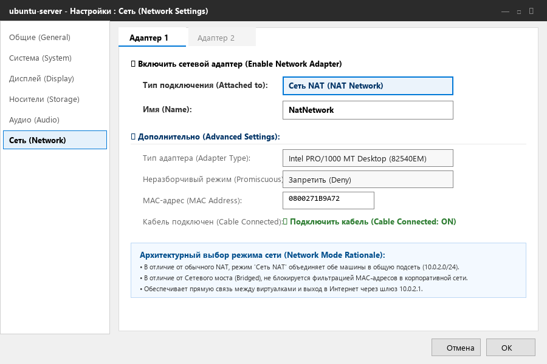
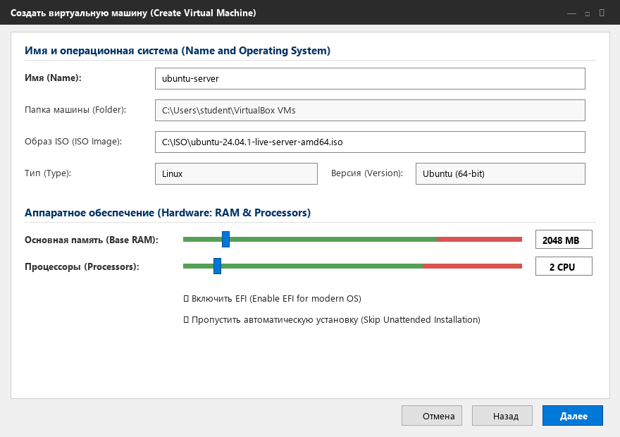
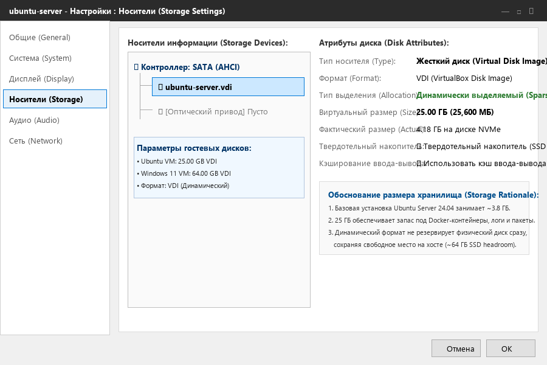
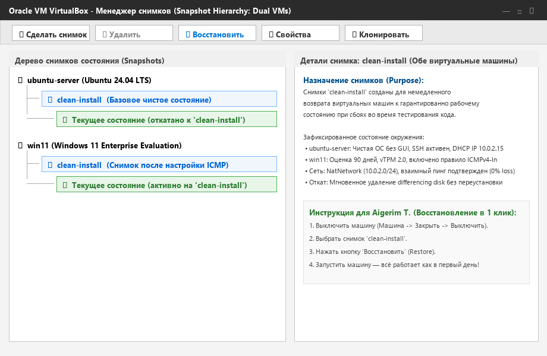

# BUILD.md: Step-by-Step VM Deployment Guide

**Target Audience:** Aigerim T. (Office Manager) / Junior IT Support  
**Environment:** Oracle VM VirtualBox 7.0 on Windows 11 (16 GB RAM Host)  
**Deliverables:** Two connected virtual machines (`ubuntu-server` and `win11`) on a private shared network with Internet access and baseline recovery snapshots.

*(Примечание: Все ключевые пункты содержат названия на русском языке в скобках, так как интерфейс VirtualBox в офисе установлен на русском языке).*

---

## Quick Reference Summary (Cheat Sheet)

| Virtual Machine | Name | OS Type | RAM | vCPUs | Virtual Disk | Network Mode | Snapshot Name |
| :--- | :--- | :--- | :---: | :---: | :---: | :--- | :--- |
| **Backend Node** | `ubuntu-server` | Ubuntu (64-bit) | **2048 MB** | **2 CPU** | **25.0 GB** (VDI, Dynamic) | Сеть NAT (`NatNetwork`) | `clean-install` |
| **Client Node** | `win11` | Windows 11 (64-bit) | **4096 MB** | **2 CPU** | **64.0 GB** (VDI, Dynamic) | Сеть NAT (`NatNetwork`) | `clean-install` |

---

## Step 0: Prerequisites Checklist

Before starting, ensure you have:
1. **VirtualBox 7.0+** installed on the workstation.
2. At least **40 GB of free space** on disk `C:`.
3. The following two official ISO files downloaded and placed in `C:\ISO\`:
   * `ubuntu-24.04.1-live-server-amd64.iso` (Ubuntu Server LTS)
   * `Win11_23H2_Enterprise_Eval_x64.iso` (Official Microsoft Evaluation ISO)

---

## Step 1: Configure the Shared NAT Network (`NatNetwork`)

This step creates the virtual router that allows both virtual machines to talk to each other and access the Internet.

1. Open **Oracle VM VirtualBox**.
2. In the top menu, click **File** -> **Tools** -> **Network Manager** (*Файл -> Инструменты -> Сетевой менеджер*).
3. Switch to the **NAT Networks** tab (*Сети NAT*).
4. Click the **Create** button (*Создать* / зеленая иконка с плюсом).
5. A new network named **`NatNetwork`** will appear:
   * **Network Name:** `NatNetwork`
   * **IPv4 Prefix:** `10.0.2.0/24`
   * Check the box: ☑ **Enable DHCP** (*Включить DHCP*).
   * Uncheck IPv6 (not needed).
6. Click **Apply** (*Применить*).



> **Why this option and not another:** Standard NAT isolates each virtual machine in a separate private sandbox where they cannot see or ping each other, while Bridged mode gets silently dropped by campus/office network port security due to MAC address filtering. The **NAT Network** mode places both guests on a shared private subnet (`10.0.2.0/24`) while presenting a single authenticated host MAC address to the outside network for reliable Internet access.

---

## Step 2: Build the Ubuntu Server VM (`ubuntu-server`)

1. In the main VirtualBox window, click **New** (*Создать* / синяя кнопка).
2. **Name and Operating System (*Имя и операционная система*):**
   * **Name (*Имя*):** `ubuntu-server`
   * **Folder (*Папка*):** `C:\Users\student\VirtualBox VMs` (default)
   * **ISO Image (*Образ ISO*):** Click the arrow, browse to `C:\ISO\ubuntu-24.04.1-live-server-amd64.iso`.
   * **Type (*Тип*):** `Linux`
   * **Version (*Версия*):** `Ubuntu (64-bit)`
   * ☑ Check the box: **Skip Unattended Installation** (*Пропустить автоматическую установку*).
   * Click **Next** (*Далее*).
3. **Hardware (*Аппаратное обеспечение*):**
   * **Base Memory (*Основная память*):** Set slider to **`2048 MB`** (2.0 GB).
   * **Processors (*Процессоры*):** Set slider to **`2 CPU`**.
   * ☑ Check the box: **Enable EFI** (*Включить EFI*).
   * Click **Next** (*Далее*).



> **Why this option and not another:** We allocate **2048 MB RAM and 2 vCPUs** because Ubuntu Server runs completely in console mode without a heavy graphical desktop, meaning 2 GB provides ample headroom for Docker and backend databases while preserving over 10 GB of physical RAM for the Windows 11 host and the second VM. We enable EFI because modern operating systems utilize UEFI partition tables and secure bootloaders.

---

## Step 3: Configure Storage and Dynamic Hard Disk

1. **Virtual Hard Disk (*Виртуальный жесткий диск*):**
   * Select: **Create a Virtual Hard Disk Now** (*Создать новый виртуальный жесткий диск*).
   * **Disk Size (*Размер диска*):** Set to **`25.00 GB`**.
   * Choose disk format: **VDI (VirtualBox Disk Image)**.
   * Choose allocation: **Dynamically allocated (*Динамический*)**.
   * Click **Finish** (*Готово*).
2. **Attach to Network (*Настройка сети*):**
   * Right-click `ubuntu-server` -> **Settings** (*Настроить*).
   * Go to **Network** (*Сеть*) -> **Adapter 1** (*Адаптер 1*).
   * **Attached to (*Тип подключения*):** Select **NAT Network** (*Сеть NAT*).
   * **Name (*Имя*):** Select **`NatNetwork`**.
   * Click **OK**.
3. **Install the OS (*Установка системы*):**
   * Click **Start** (*Запустить*).
   * Choose minimal server install (no desktop GUI).
   * In "SSH Setup", check the box: ☑ **Install OpenSSH server**.
   * Finish installation, reboot, and remove the ISO image.



> **Why this option and not another:** We select a **Dynamically Allocated VDI** rather than a Fixed Size disk because a dynamic disk only occupies space on the host SSD as data is actually written (~4.2 GB initially), preventing unnecessary consumption of the host's remaining 64 GB free drive capacity. We enable OpenSSH to allow the developer to manage the server headlessly over the network.

---

## Step 4: Build the Windows 11 VM (`win11`) & Configure Firewall

1. In VirtualBox, click **New** (*Создать*).
2. **Name and Operating System:**
   * **Name (*Имя*):** `win11`
   * **ISO Image (*Образ ISO*):** Select `C:\ISO\Win11_23H2_Enterprise_Eval_x64.iso`.
   * **Type:** `Microsoft Windows`, **Version:** `Windows 11 (64-bit)`.
   * ☑ Check: **Skip Unattended Installation** (*Пропустить автоматическую установку*).
   * Click **Next** (*Далее*).
3. **Hardware & Virtual Disk:**
   * **Base Memory:** Set slider to **`4096 MB`** (4.0 GB).
   * **Processors:** Set slider to **`2 CPU`**.
   * ☑ Check: **Enable EFI** (*Включить EFI*).
   * **Hard Disk:** Set size to **`64.00 GB`** (VDI, dynamically allocated).
   * Click **Finish** (*Готово*).
4. **Attach to Network:**
   * Right-click `win11` -> **Settings** (*Настроить*) -> **Network** (*Сеть*).
   * **Attached to (*Тип подключения*):** Select **NAT Network** (*Сеть NAT*), Name: **`NatNetwork`**.
5. **Install Windows 11 & Configure Firewall for Ping:**
   * Complete standard setup (choose 90-day Evaluation; do not enter a license key).
   * Open **PowerShell as Administrator** and execute:
     ```powershell
     Enable-NetFirewallRule -Name "FPS-ICMP4-ERQ-In"
     ```


> **Why this option and not another:** Windows 11 strictly enforces a **4096 MB RAM minimum** and TPM 2.0 / EFI during installation, so allocating less than 4 GB causes the installer to fail. We enable the specific ICMPv4 inbound firewall rule rather than turning off Windows Defender Firewall because disabling the entire firewall strips away stateful packet inspection, exposing RPC and SMB ports to unauthorized lateral movement.

---

## Step 5: Create Baseline Snapshots (`clean-install`)

This is the safety net that lets the developer reset the computer in 10 seconds if anything breaks.

1. **Shut down both virtual machines** cleanly from inside their respective operating systems.
2. In VirtualBox, select **`ubuntu-server`**:
   * Click the menu icon next to the VM name and select **Snapshots** (*Снимки*).
   * Click **Take** (*Сделать снимок* / иконка фотоаппарата).
   * **Name (*Имя снимка*):** `clean-install`
   * **Description (*Описание*):** `Baseline clean install. Ubuntu 24.04 LTS, SSH active, IP 10.0.2.15.`
   * Click **OK**.
3. Repeat for **`win11`**:
   * Select `win11` -> **Snapshots** (*Снимки*) -> **Take** (*Сделать снимок*).
   * **Name:** `clean-install`
   * **Description:** `Baseline clean install. Windows 11 Enterprise Eval, ICMP rule enabled, IP 10.0.2.16.`
   * Click **OK**.



> **Why this option and not another:** We create snapshots immediately after completing the baseline setup **before** the new developer begins testing. Taking a snapshot *prior* to experimentation creates an immutable Copy-on-Write reference point; taking a snapshot after an error or misconfiguration occurs permanently preserves the corrupted state, rendering recovery impossible.

---

## Step 6: 2-Minute Verification Checklist & Rollback Procedure

Start both virtual machines and execute these quick checks:

### 1. Verify IP Addressing
* On **Ubuntu**, run `ip -brief addr show enp0s3`. Expected: `10.0.2.15`.
* On **Windows**, open Command Prompt, run `ipconfig`. Expected: `10.0.2.16`.

### 2. Verify Bidirectional Ping Between Guests
* On **Ubuntu**, run:
  ```bash
  ping -c 4 10.0.2.16
  ```
  *(Result: `4 packets transmitted, 4 received, 0% packet loss`).*
* On **Windows**, run:
  ```cmd
  ping 10.0.2.15
  ```
  *(Result: `Packets: Sent = 4, Received = 4, Lost = 0 (0% loss)`).*

### 3. Verify External Internet Reachability
* On both guests, execute `ping 1.1.1.1`. Both must receive successful ICMP replies.

---

## Disaster Recovery: How to Roll Back in 10 Seconds

If the developer breaks the software environment, deletes system files, or corrupts network settings:
1. In VirtualBox, right-click the broken VM -> **Close** -> **Power Off** (*Закрыть -> Выключить*).
2. Go to **Snapshots** (*Снимки*).
3. Select the snapshot named **`clean-install`**.
4. Click **Restore** (*Восстановить* / иконка со стрелочкой).
5. Start the machine — it boots back to its original pristine state with 0 data corruption!
